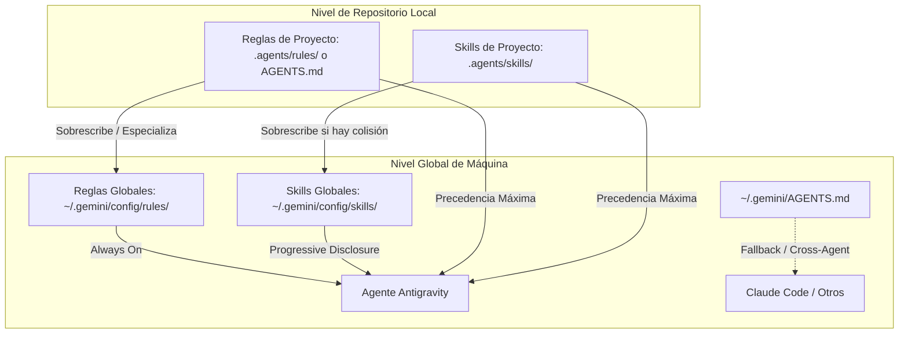

# Sistema Personal de Desarrollo Asistido por IA
## Arquitectura Modular, Reglas Globales y Agent Skills Portables

Este documento detalla la arquitectura, el diseño y la implementación del sistema personal de desarrollo con agentes de IA configurado en el entorno local, optimizado para **Antigravity IDE**, **Claude Code** y cualquier agente compatible con el estándar abierto **Agent Skills**.

---

## 1. Diagnóstico del Entorno (Fase 1)

Previo a la creación de archivos, se auditó el entorno local de configuración:

| Ubicación | Estado Encontrado | Acción Tomada |
| :--- | :--- | :--- |
| `~/.gemini/config/` | Existente (contenía `config.json`, `mcp_config.json`, `plugins/`) | Respetado sin modificaciones a los archivos existentes. |
| `~/.gemini/config/rules/` | Inexistente | Creado como raíz modular para reglas globales. |
| `~/.gemini/config/skills/` | Inexistente | Creado como raíz para skills en formato estándar. |
| `~/.gemini/AGENTS.md` | Inexistente | Creado como archivo consolidado para agentes jerárquicos. |
| `~/.claude/` | No configurado aún en la máquina | Se preparó script de enlace simbólico zero-copy (`sync-agent-skills.sh`). |
| Plugins instalados | 4 plugins detectados (`chrome-devtools`, `gemini-api`, `google-antigravity-sdk`, `modern-web-guidance`) | Preservados intactos en su ubicación actual. |

---

## 2. Jerarquía de Configuración y Mecanismo de Descubrimiento

El sistema implementa una estricta separación de responsabilidades para evitar la contaminación cruzada entre proyectos y lenguajes:



### Reglas de Precedencia y Deduplicación
1. **Reglas del Repositorio (`.agents/rules/*.md` o `./AGENTS.md`)**: Tienen la mayor prioridad. Definen comandos de build, testing, dependencias y arquitectura del proyecto concreto.
2. **Reglas Globales (`~/.gemini/config/rules/*.md`)**: Establecen estándares de calidad, seguridad y workflow independientes del lenguaje.
3. **Deduplicación automática**: El sistema normaliza las rutas resueltas para evitar inyectar la misma regla más de una vez en un turno de conversación.
4. **Revelación Progresiva (Progressive Disclosure)**: Las skills no se cargan completas en el contexto del modelo. Solo sus metadatos (`name` y `description`) se inyectan en el prompt inicial; el contenido detallado de `SKILL.md` se lee únicamente cuando la tarea lo requiere.

---

## 3. Inventario de Reglas Globales Creadas

Ubicación: `~/.gemini/config/rules/` (y consolidado en `~/.gemini/AGENTS.md`)

1. **`engineering-standards.md`**:
   - Corrección, legibilidad, simplicidad (KISS) y mantenibilidad.
   - Inspección previa obligatoria del código antes de escribir.
   - Prohibición de abstracciones prematuras y capas innecesarias (YAGNI).
   - Preservación estricta de contratos de APIs y retrocompatibilidad.
   - Identificación proactiva de casos borde, concurrencia y manejo explícito de errores.
   - Cero asunciones: verificar con hechos observables, nunca inventar requisitos ni APIs.
2. **`workflow.md`**:
   - Clasificación de tareas: atómicas directas vs. complejas planificadas por fases.
   - Descomposición incremental verificable.
   - Consulta obligatoria a documentación primaria oficial ante dudas de versiones o APIs.
   - Verificación continua con herramientas nativas del proyecto.
   - Transparencia radical: reporte de resultados reales, fallos y verificaciones omitidas.
   - Auditoría final de `git diff` para prevenir cambios accidentales o código muerto.
3. **`safety-autonomy.md`**:
   - Gestión estricta de secretos: variables de entorno, `.gitignore`, cero credenciales en commits.
   - Restricción de comandos destructivos (`rm -rf`, resets duros, borrado de datos).
   - Austeridad en dependencias: priorizar biblioteca estándar antes de añadir paquetes externos.
   - Alcance acotado: no modificar archivos fuera del foco de la tarea.
   - Puntos de parada para autorización humana en acciones irreversibles.

---

## 4. Catálogo de Agent Skills Creadas

Ubicación: `~/.gemini/config/skills/<skill_name>/SKILL.md`  
Todas cumplen la especificación abierta **Agent Skills** con YAML frontmatter válido.

### Skills de Procedimiento General

| Skill | Activación Principal | Responsabilidad Central |
| :--- | :--- | :--- |
| **`debugging`** | Errores en ejecución, tests rotos, crashes o comportamiento anómalo | Aislamiento, caso mínimo reproducible, formulación de hipótesis falsables, fix de causa raíz sin parches sintomáticos y test de regresión. |
| **`code-review`** | Diffs locales, PRs, ramas o fragmentos antes de merge | Revisión estructurada de solo lectura evaluando 6 dimensiones (corrección, seguridad, tipos, a11y, performance, mantenibilidad) clasificada por severidad. |
| **`testing`** | Creación de tests, validación de refactors o análisis de cobertura | Descubrimiento del toolchain real del proyecto, diseño de casos límite (AAA), ejecución dirigida y reporte transparente de métricas. |
| **`safe-refactor`** | Reducción de complejidad y deuda técnica sin cambio funcional | Verificación de baseline con tests, preservación de invariantes, pasos atómicos, regla de tres contra sobreingeniería y auditoría de diff. |
| **`feature-implementation`** | Nuevos requisitos, endpoints, modelos o interfaces | Descomposición en criterios de aceptación, diseño por capas, ejecución incremental y contención estricta de alcance (zero scope creep). |
| **`technical-research`** | Dudas sobre APIs, evaluación de dependencias o versiones | Jerarquía de verdad (fuentes primarias > código upstream), verificación de versiones reales y distinción formal entre hechos, recomendaciones e incertidumbres. |
| **`project-onboarding`** | Inicio en repositorios nuevos o auditoría de proyectos | Reconocimiento de manifiestos, mapeo de arquitectura, detección de inconsistencias y propuesta de configuración local mínima sin invadir el proyecto. |

### Skills de Especialización Técnica

| Skill | Activación Principal | Directrices Clave |
| :--- | :--- | :--- |
| **`react-typescript`** | Componentes, hooks, tipos y estado en React | Detección de versión (React 18 vs 19), prohibición estricta de `any`, estado derivado sobre `useEffect`, sin `useMemo` prematuro, HTML semántico accesible y tests con React Testing Library. |
| **`go-development`** | Servicios, paquetes y CLI en lenguaje Go | Filosofía idiomática ("Accept interfaces, return structs"), paquetes específicos (sin `util`), envoltura con `fmt.Errorf("...: %w", err)`, propagación de `context.Context`, goroutines con parada segura y tests table-driven. |
| **`godot-gdscript`** | Videojuegos y herramientas en Godot Engine | Tipado estático en GDScript 2.0 (Godot 4), patrón "Call Down, Signal Up", uso de `Resource` para datos desacoplados, optimización de `_physics_process` / `_process` y prevención de memory leaks con `queue_free()`. |

---

## 5. Matriz de Interoperabilidad con Claude Code y Otros Agentes

| Entorno / Agente | Soporte de Reglas Globales | Soporte de Skills | Mecanismo de Enlace |
| :--- | :--- | :--- | :--- |
| **Antigravity IDE** | `~/.gemini/config/rules/*.md` y `~/.gemini/AGENTS.md` | `~/.gemini/config/skills/*/SKILL.md` | **Nativo automático**. Descubierto en el customization root. |
| **Claude Code** | `~/.claude/CLAUDE.md` | `~/.claude/skills/*/SKILL.md` | Enlace simbólico con el script provisto `~/.gemini/config/scripts/sync-agent-skills.sh`. |
| **Cursor / Codex** | `.agents/rules/*.md` o `./AGENTS.md` | `skills/*/SKILL.md` | Lectura de `AGENTS.md` en raíz del proyecto o enlaces locales. |

### Comando de Sincronización para Claude Code
Para activar las skills en Claude Code cuando esté instalado:
```bash
~/.gemini/config/scripts/sync-agent-skills.sh
```
El script crea los enlaces simbólicos `~/.claude/skills -> ~/.gemini/config/skills` y `~/.claude/CLAUDE.md -> ~/.gemini/AGENTS.md` preservando una única fuente de verdad.

---

## 6. Procedimiento para Incorporar Nuevas Especializaciones Técnicas

Para agregar un nuevo lenguaje o framework (por ejemplo: `rust-development` o `python-backend`) sin romper el sistema:

1. **Crear el directorio de la skill**:
   ```bash
   mkdir -p ~/.gemini/config/skills/<nombre-skill>
   ```
2. **Crear el archivo `SKILL.md`**:
   - Encabezado YAML con `name` (coincidente con la carpeta) y `description` (en tercera persona, indicando cuándo activarse).
   - Secciones obligatorias: *Propósito*, *Criterios de Activación*, *Directrices Técnicas*, *Condiciones de Seguridad* y *Checklist de Verificación Final*.
3. **Validar con el script de comprobación**:
   - Verificar sintaxis YAML y reglas de progressive disclosure.
4. **Interoperabilidad**:
   - Si se utiliza el script de sincronización con Claude Code, la nueva skill queda disponible inmediatamente sin pasos manuales adicionales.
